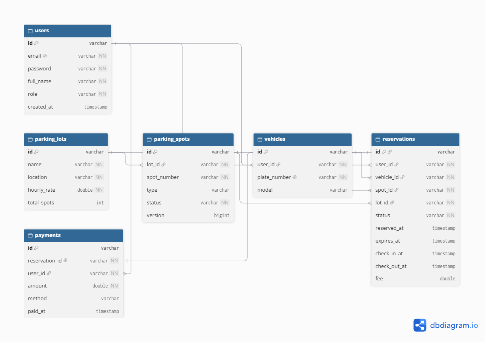

# Smart Parking System

A microservices app where drivers find a free parking spot, reserve it for 15 minutes, check in, and pay when they leave.

## Problem statement

Drivers waste time looking for parking, and two people can end up going to the same spot. This project lets users see live spot availability and reserve a spot, and it guarantees that **only one user can reserve a given spot**, even when many requests arrive at the same time.

## Team

| Name  | Owns |
|-------|---|
| Hasan | auth-service (authentication and JWT security) |
| Ali   | parking-service (lots, spots, locking) |
| Sara  | reservation-service (reservations, fees) |
| Alya  | Docker, MongoDB Atlas setup, integration testing, documentation |

## Technologies

- Java 21 and Spring Boot
- Spring Security with JWT
- MongoDB Atlas
- Docker and Docker Compose
- React (frontend)
- Postman (API testing)
## Architecture

Three independent Spring Boot services, each with its own database on one Atlas cluster. Services talk to each other over HTTP and never read each other's collections.

| Service | Port | Database | Collections |
|---|---|---|---|
| auth-service | 8081 | `auth_db` | `users` |
| parking-service | 8082 | `parking_db` | `parking_lots`, `parking_spots` |
| reservation-service | 8083 | `reservation_db` | `vehicles`, `reservations`, `payments` |
| frontend | 5173 | none | none |

reservation-service calls parking-service to reserve and release spots. All services validate the same JWT using a shared secret.
## ERD Diagram


## Concurrency

When two users try to reserve the same spot, parking-service protects it in two layers:

1. A `ReentrantLock` per spot id, so only one thread at a time handles that spot.
2. An atomic MongoDB update that only succeeds if the spot is still `AVAILABLE`. If it is already taken, the API returns **409 Conflict**.

## Running the app

### Requirements

- Java 21
- Docker Desktop
- A MongoDB Atlas cluster (free M0 tier)
### 1. Set up MongoDB Atlas

1. Create a free M0 cluster at cloud.mongodb.com.
2. Under **Security → Database Access**, create a database user with read/write access. Use a password with only letters and numbers.
3. Under **Security → Network Access**, add `0.0.0.0/0` (allow from anywhere) for development.
4. Click **Connect → Drivers → Java** and copy the connection string.
   The databases and collections are created automatically the first time each service saves data.

### 2. Set environment variables

Copy the example file and fill in your values:

```
cp .env.example .env
```

| Variable | Description |
|---|---|
| `MONGO_URI` | Atlas connection string, with your real password in place of the placeholder |
| `JWT_SECRET` | Random string of at least 32 characters, the same for every service |
| `PARKING_SERVICE_URL` | Address reservation-service uses to reach parking-service (`http://parking-service:8082` in Docker) |


### 3. Run with Docker

```
docker compose up --build
```

Then open:

- auth-service: http://localhost:8081
- parking-service: http://localhost:8082
- reservation-service: http://localhost:8083
  Stop everything with `docker compose down`.

### Run a single service without Docker

```
cd parking-service
./mvnw spring-boot:run
```

Set `MONGO_URI` and `JWT_SECRET` in your environment first.

## API endpoints

| Service | Endpoint | Access |
|---|---|---|
| auth | `POST /auth/register` | public |
| auth | `POST /auth/login` | public |
| parking | `GET /lots` | USER |
| parking | `GET /lots/{id}/spots?status=` | USER |
| parking | `POST/PUT/DELETE /lots`, `POST/PUT/DELETE /spots` | ADMIN |
| parking | `PATCH /spots/{id}/reserve`, `/occupy`, `/release` | internal |
| reservation | `POST /reservations` | USER |
| reservation | `PATCH /reservations/{id}/check-in`, `/check-out`, `/cancel` | USER |
| reservation | `GET /reservations/me` | USER |
| reservation | `GET/POST/DELETE /vehicles` | USER |

A Postman collection is in `docs/smart-parking.postman_collection.json`.

## Status codes

| Code | Meaning |
|---|---|
| 200 / 201 | Success / created |
| 400 | Invalid input |
| 401 | Missing or invalid token |
| 403 | Not allowed for your role |
| 404 | Not found |
| 409 | Spot already taken |

## Screenshots

Add images to `docs/screenshots/` and link them here.

## Project structure

```
Smart-Parking-System/
├── auth-service/
├── parking-service/
├── reservation-service/
├── frontend/
├── docs/
├── docker-compose.yml
├── .env.example
└── README.md
```
